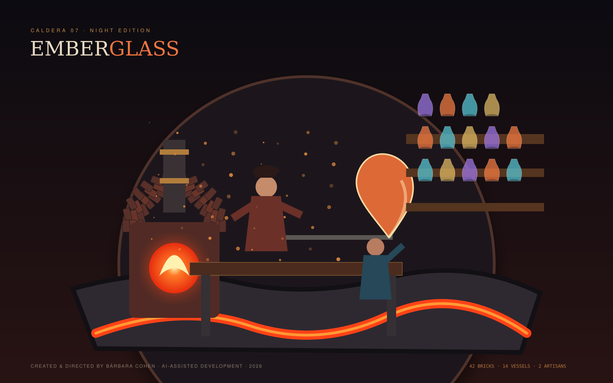

# EMBERGLASS — The Caldera Studio

Shape three live glass commissions inside an inhabited miniature studio built into a volcanic caldera.



## Why this exists

Glassblowing is a negotiation between heat, rotation, breath and time. Emberglass turns that relationship into a compact browser simulation rather than a sequence of cosmetic buttons. Every control changes the same vessel state, and the finished silhouette is scored against a visible commission profile.

## Features

- A fully modeled miniature hot shop: 42 furnace bricks, two artisans, archive shelves, tools, annealing kiln, coal cart, lava channels, sparks and glass displays.
- Three distinct commissions with different target profiles and temperature windows.
- Procedural vessel geometry rebuilt from body, neck and rim parameters while you work.
- Heat, rotation, breath, symmetry, stress, annealing, recoverable fracture and final grading.
- Pointer/touch controls, keyboard shortcuts, orbit camera, cinematic camera and responsive layout.
- Local progress saving, reduced-motion support and WebGL context-loss handling.
- A completely offline single-file build in `dist/`.

## Run

The fastest route is to open:

```text
dist/Emberglass-Demo-2026-09-27.html
```

For the readable source version:

```bash
python3 -m http.server 8080
# open http://localhost:8080
```

No API key, account, paid service or package installation is required.

## GitHub repository

- **Suggested slug:** `emberglass-caldera-studio`
- **Description:** Shape three live glass commissions inside an inhabited 3D volcanic studio.
- **Topics:** `threejs`, `webgl`, `interactive-3d`, `cozy-game`, `simulation`, `procedural-art`, `creative-coding`

For manual upload, create an empty repository and upload this folder with `README.md` and `index.html` at the root. To publish the playable version, enable GitHub Pages from the repository’s main branch and root directory. No repository or deployment is created automatically by this package.

## Controls

| Action | Keyboard | Interface |
| --- | --- | --- |
| Furnace heat | Q / E | Heat slider |
| Blowpipe rotation | A / D | Rotation slider |
| Blow | Hold B | Hold Blow |
| Paddle | 1 | Paddle |
| Jacks | 2 | Jacks |
| Shears | 3 | Shears |
| Reheat | R | Reheat |
| Anneal | Enter | Anneal |
| Orbit / zoom | Drag / wheel | Touch drag / pinch browser zoom |

## Architecture

- `src/data.js` — immutable commissions, tools, palette and scene manifest.
- `src/sim.js` — renderer-independent state machine, heat model, shaping rules, scoring and save validation.
- `src/scene.js` — Three.js scene adapter, procedural geometry, camera and context lifecycle.
- `src/app.js` — input mapping, DOM HUD, persistence, overlays and audio feedback.
- `build.cjs` — creates the dependency-free single-file demo.

Simulation state never lives inside Three.js meshes. The renderer consumes snapshots and can be replaced without rewriting rules or save files.

## Test and build

```bash
npm test
npm run build
npm run preview
```

The tests cover progression gates, control clamping, thermal behavior, shaping tools, symmetry, fractures, recovery, scoring, grades, save validation, packaging, accessibility hooks, local assets and renderer recovery.

## Honest limitations

- This is an expressive simulation, not a physically exact computational-fluid-dynamics model of molten glass.
- Procedural geometry favors visual clarity over manufacturing accuracy.
- The included preview is an illustration generated from the real scene manifest; it is not a browser screenshot.

## Authorship

Created and creatively directed by **Bárbara Cohen**. AI-assisted development is disclosed here and in the source. No client work, adoption figures, professional experience or credentials are claimed.

## License

Project code is MIT licensed. Three.js 0.160.0 is included under its own MIT license; see `THIRD_PARTY_NOTICES.md`.
